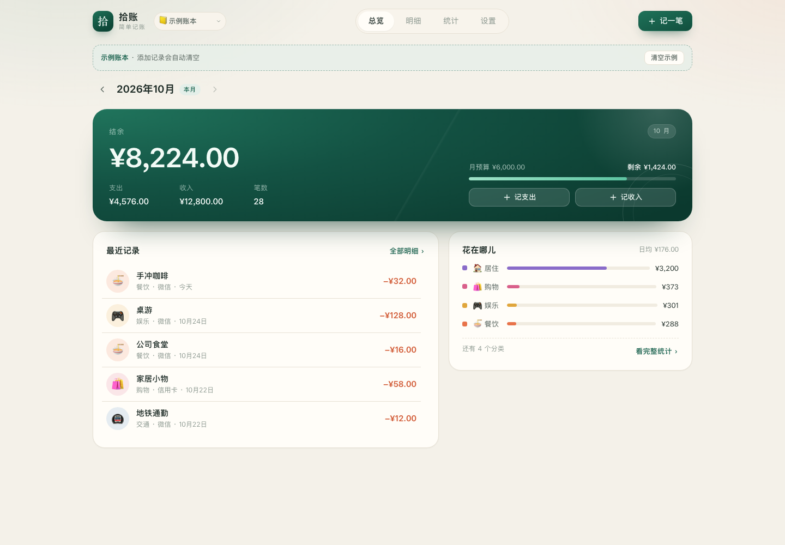
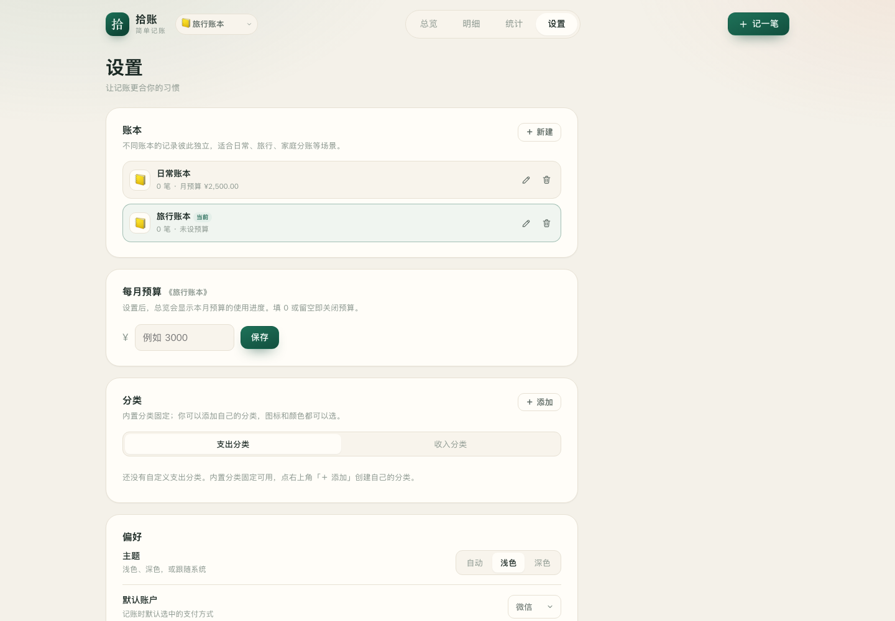
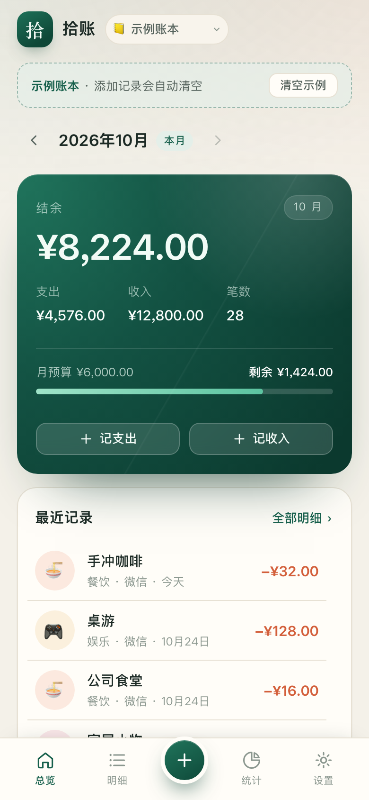

# 拾账 · 简单记账

一个**不用注册、不联网、打开就能用**的个人记账应用。原生 HTML / CSS / JavaScript，没有构建步骤，也没有第三方依赖。

现在支持 **多账本**、**自定义分类**，以及**安装到手机/电脑桌面**（PWA，可离线打开）。

> 把每一笔，记得清楚。



## 快速开始

1. 双击 **`index.html`**（推荐 Chrome / Edge，Safari 也可以）。
2. 想先看效果？点空状态里的「看看示例」，或到「设置 → 示例账本」。示例是独立账本，不会动你的真实记录。
3. 顶部左侧的下拉框可以切换账本、新建账本；记账时点右上角「记一笔」或手机底部的 **＋**。
4. 想把应用装到桌面，见下面的「安装到桌面（PWA）」。

不需要安装 Node、不需要 npm install，直接打开文件即可使用。

## 功能

- **多账本**：日常、旅行、家庭分账各自独立；每个账本有自己的预算，顶部下拉即可切换。
- **自定义分类**：内置 10 个支出 + 6 个收入分类；可以添加自己的分类，选图标和颜色。删除自定义分类时，关联记录会自动归入「其他」。
- **快速记账**：大号数字键盘，支持支出 / 收入、5 个账户、日期、备注；点击记录即可编辑或删除。
- **总览**：当月结余、收支、笔数、预算进度、最近记录、支出构成。
- **明细**：按天分组，支持关键词搜索，按收支类型、分类、月份筛选。
- **统计**：分类环形图、近 6 个月趋势、支出排行、日均支出。
- **PWA**：安装到桌面、离线打开；首次联网打开后会缓存应用外壳。
- **数据**：CSV 导出（Excel 可直接打开）、JSON 备份（包含全部账本和分类）、恢复备份、清空当前账本。
- **主题**：自动跟随系统，也可手动浅色 / 深色。
- **迁移**：自动识别旧版单账本数据，迁移到「日常账本」；旧版示例数据会迁移到独立的「示例账本」。






## 安装到桌面（PWA）

浏览器要求页面通过 **HTTPS** 或 **localhost** 打开，才能启用 Service Worker 和安装；直接双击 `file://` 的本地文件不能安装，也不会离线缓存。记账功能本身不受影响。

### 推荐：部署到 HTTPS

任选一个静态托管（都不需要后端）：

- **Netlify Drop**：打开 <https://app.netlify.com/drop>，把整个 `记账本` 文件夹拖进去，会得到一个 HTTPS 地址。
- **GitHub Pages**：见下面的逐步操作。
- **Vercel / Cloudflare Pages**：导入文件夹或仓库，按静态站点部署。

### GitHub Pages 逐步操作

1. 在 GitHub 新建一个 **public** 仓库，名字建议用 `shizhang`（免费账号的 Pages 需要公开仓库），**不要**勾选初始化 README / .gitignore。
2. 在本机打开终端，进入 `记账本` 文件夹，初始化并推送：

```bash
cd "记账本"
git init -b main
git add .
git commit -m "feat: 拾账 v2.0"
git remote add origin https://github.com/<你的用户名>/shizhang.git
git push -u origin main
```

   > HTTPS 推送需要 GitHub Personal Access Token 或 GitHub Desktop；如果嫌命令行麻烦，可以用 **GitHub Desktop**：Add Local Repository 选中 `记账本`，再 Publish repository（选 public）。
   >
   > 公开仓库的 commit 会显示本机 Git 配置的邮箱。介意的话先执行：
   > `git config user.email "<你的GitHub用户名>@users.noreply.github.com"`。

3. 打开仓库的 **Settings → Pages**：
   - **Source** 选 **Deploy from a branch**
   - **Branch** 选 `main`，目录选 `/(root)`
   - 点 **Save**
   - 如果有 **Enforce HTTPS**，勾上。

4. 等 1–2 分钟，访问：

```text
https://<你的用户名>.github.io/shizhang/
```

   `.nojekyll` 已经放在项目里，GitHub Pages 会按静态文件原样发布，不会再走 Jekyll 构建。

5. 用手机打开这个 HTTPS 地址，按上面的「手机上安装」操作即可。PWA 的 Scope 和 Service Worker 路径已经按 `/shizhang/` 这种项目子路径验证过。

以后更新：修改文件后 `git add . && git commit -m "update" && git push`，Pages 会自动重新发布。如果改了 `index.html` / `styles.css` / `app.js`，记得把 `sw.js` 里的 `VERSION` 加一，让已安装的 PWA 拉取新缓存。

### 手机上安装

- **Android / Chrome**：打开 HTTPS 地址，点浏览器菜单里的「安装应用 / 添加到主屏幕」，或直接点「设置 → 安装到桌面」里的按钮。
- **iPhone / iPad**：必须用 **Safari** 打开，点底部「分享」→「添加到主屏幕」。iOS 上的 Chrome 不能安装 PWA。
- 安装后第一次打开会缓存应用外壳；之后断网也能打开，数据仍然只存在这台设备。

### 本机测试

```bash
cd "记账本"
python3 -m http.server 8000
```

电脑浏览器访问 `http://localhost:8000`（localhost 属于安全上下文，可以安装）；手机要访问电脑的局域网 IP 时，需要 HTTPS 才能安装，正式使用建议直接部署。

> **数据不会跟着地址走**：`file://`、`localhost`、线上 HTTPS 是三个不同的浏览器来源，`localStorage` 彼此独立。如果已经在本地文件里记过账，请先在「设置 → 数据 → 备份 JSON」，再到安装后的版本里恢复；也可以在浏览器里把旧数据导出后导入。

## 数据、迁移与备份

- 数据保存在当前浏览器的 `localStorage` 中，键名沿用 `shizhang.v1`（内部结构已升级到 v2，以兼容旧数据），不会上传到任何服务器。
- **升级 v1 数据**：启动时自动迁移，不需要手动操作。旧预算会跟随「日常账本」，旧示例数据会进入「示例账本」。
- **JSON 备份**：包含全部账本、分类、记录和设置；恢复时既可以导入新版备份，也兼容旧版（v1）备份。
- **CSV 导出**：只导出当前账本，带 BOM，中文在 Excel 中不会乱码。
- 清除浏览器网站数据、使用无痕模式，或换一台设备，都看不到原来的记录。换设备前请先备份 JSON。

- 分类是全局的：自定义分类在所有账本里都能用；记录和预算按账本隔离。

## 键盘快捷键（桌面端）

| 按键 | 作用 |
| --- | --- |
| `0`–`9`、`.` | 输入金额 |
| `Backspace` | 退格 |
| `Enter` | 保存 |
| `Esc` | 关闭记账面板 / 弹窗 |

## 文件结构

```text
记账本/
├── index.html              # 页面结构 + 内联 SVG 图标
├── styles.css              # 全部样式（响应式、深浅色）
├── app.js                  # 数据、渲染、交互、导入导出
├── manifest.json           # PWA 清单
├── sw.js                   # Service Worker（离线缓存）
├── .nojekyll               # 让 GitHub Pages 跳过 Jekyll
├── icons/                  # PWA / iOS 图标
├── preview/                # 各尺寸截图（演示数据）
├── README.md
└── tools/
    ├── shot.mjs            # Chrome 无头截图 + 界面回归
    └── pwa-test.mjs        # 本地 HTTP + Manifest/SW/离线测试
```

## 开发与测试

没有依赖和构建流程，改完直接刷新页面即可。

```bash
node tools/shot.mjs      # 桌面/移动端截图 + 记账/账本/分类/导入导出回归
node tools/pwa-test.mjs  # 启动本地 HTTP，检查 manifest、SW、安装条件、断网重载
```

- `shot.mjs` 覆盖 1440 / 768 / 390 / 320 宽度，浅色/深色、记账面板、空账本、滚动吸顶、旧数据迁移、备份恢复等。
- `pwa-test.mjs` 会启动一个临时静态服务器，并模拟 GitHub Pages 的 `/shizhang/` 子路径，检查 `manifest`、图标、Service Worker、Scope、安装条件和离线重载。
- 两个脚本都使用 macOS 的 Google Chrome，并带 `--no-sandbox` 以适配受限运行环境；换机器时按需修改文件顶部路径。
- 当前回归结果：46 项界面检查 + 10 项 PWA 检查全部通过（截图见 `preview/`）。

修改 `index.html` / `styles.css` / `app.js` 后，如果要让已安装的 PWA 更新，请把 `sw.js` 里的 `VERSION` 加一，避免继续使用旧缓存。

## 云同步：尚未接入

这一版**没有**云同步。它不是纯前端功能，至少需要：账号体系、后端存储、冲突合并策略。

现在能做的是**手动同步**：在「设置 → 数据」里备份 JSON，在另一台设备恢复。

如果要继续做云同步，推荐先选一个方向：

- **Supabase**：邮箱登录 + Postgres + 行级权限，前端可以直接接，适合个人项目。
- **Firebase**：Firestore + Auth，配置简单，但数据结构和权限要单独设计。
- **自建**：自己的 API + 数据库，可控性最高，但要维护服务端。

确定方案和账号体系后，可以在这个版本上继续加。

## 已知限制

- 单浏览器、单设备；没有自动云同步。
- 分类是全局的；暂不支持每个账本单独一套分类。
- 内置分类固定，不能删除；自定义分类可以增删改。
- 暂不支持多币种、周期账单、票据附件、按分类预算。
- 数据清理不可撤销，重要记录请定期备份。
